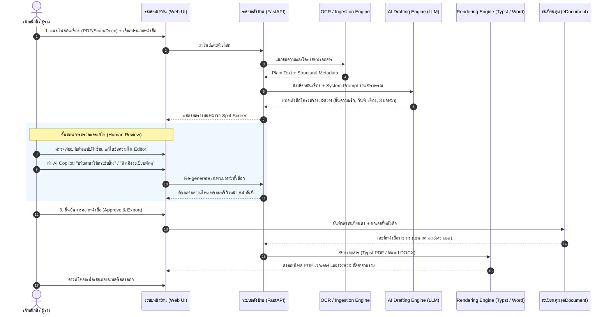

# DESIGN.md — สถาปัตยกรรมและการออกแบบระบบทำหนังสือราชการอัจฉริยะ (Thai GovDoc AI Studio)

เอกสารนี้ระบุรายละเอียดทางสถาปัตยกรรม (System Architecture), การออกแบบโมดูล (Component Design), โครงสร้างข้อมูล (Data Schemas), และข้อกำหนดการแสดงผล (Visual & Typography Specs) สำหรับระบบร่างและผลิตหนังสือราชการไทย

---

## 1. ภาพรวมของระบบ (System Overview)

ระบบ **Thai GovDoc AI Studio** เป็นแพลตฟอร์มที่เชื่อมโยงเทคโนโลยี AI สมัยใหม่ (Multimodal LLM / OCR) เข้ากับมาตรฐานงานสารบรรณไทยแบบดั้งเดิม โดยมีเป้าหมายเพื่อลดเวลาในการร่างหนังสือราชการจาก 30–60 นาทีต่อฉบับ ให้เหลือเพียงไม่ถึง 2 นาที โดยที่เอกสารยังคงความถูกต้องตามระเบียบ 100%

### จุดประสงค์หลัก (Core Pillars):
1. **Accurate Ingestion:** อ่านและเข้าใจเอกสารต้นเรื่อง (สแกน, ถ่ายภาพ, PDF, Word) ได้อย่างแม่นยำ แม้เอกสารจะมีรอยประทับหรือตัวหนังสือมัว
2. **Strict Regulation Compliance:** ร่างข้อความตามโครงสร้าง 3 ภาค (เหตุ - ข้อเท็จจริง/พิจารณา - สรุป/ประสงค์) และจัดระดับความสุภาพ/คำขึ้นต้น-ลงท้ายตามระเบียบงานสารบรรณ พ.ศ. ๒๕๒๖
3. **Seamless Human Control:** ผู้ใช้เป็นผู้ตัดสินใจขั้นสุดท้าย สามารถตรวจเทียบต้นเรื่องแบบเคียงข้าง (Side-by-side) ปรับแต่งข้อความ และมี AI Copilot คอยช่วยเหลือ
4. **Dual Production-Ready Export:** ส่งออกเป็น PDF คุณภาพสูงสุดด้วย Typst (สัดส่วนแม่นยำระดับเวกเตอร์) และไฟล์ Word (`.docx`) ที่ตัดคำภาษาไทยเต็มขอบกระดาษ (Thai Distributed) สระไม่ลอย

---

## 2. ขั้นตอนการทำงานของผู้ใช้ (User Journey & Workflow)



---

## 3. สถาปัตยกรรมระบบรายโมดูล (Component Architecture)

ระบบแบ่งออกเป็น 5 โมดูลอิสระ (Modular Decoupled Design):

### 3.1. Ingestion & Preprocessing Subsystem (`core/extractor.py`)
- **Digital Text Extraction:** ใช้ `pdfplumber` และ `pypdfium2` สำหรับ PDF ดิจิทัล และ `python-docx` สำหรับไฟล์ Word
- **Scanned Document OCR:** 
  - **Local Path:** ใช้สถาปัตยกรรมจาก `copninixh/TH-National-Document-OCR` (Tesseract Fine-tuned กับฟอนต์ TH Sarabun) พร้อม OpenCV Preprocessing:
    - Grayscale & Adaptive Thresholding
    - Deskewing (ปรับมุมเอียงของกระดาษ)
    - Stamp/Noise reduction
  - **VLM Path:** ใช้ Multimodal API (เช่น Gemini Flash / Claude Vision) ส่งภาพตรงเพื่ออ่านทั้งข้อความ ตาราง และบันทึกเกษียณหนังสือแบบเขียนมือ

### 3.2. AI Drafting & Intelligence Engine (`core/ai_drafter.py`)
- สกัดประเด็นสำคัญ (Issue Extraction):
  - วันที่ และ เลขที่หนังสือต้นเรื่อง
  - หน่วยงานผู้ส่ง และ หน่วยงานผู้รับ
  - ประเด็นปัญหา / เรื่องเดิม
  - สิ่งที่ขอความร่วมมือ / สิ่งที่ต้องการให้ดำเนินการ
- สังเคราะห์และยกร่าง (Draft Generation):
  - ประยุกต์ใช้ Rule & Prompt จาก `Boom-Vitt/claude-thai-skills`
  - ใช้ **Structured Output (Pydantic Validation)** เพื่อให้ AI คืนค่าเป็น JSON เสมอ ป้องกันข้อความผิดรูปแบบ
  - รองรับหนังสือ 2 ประเภทหลัก:
    - **หนังสือภายนอก (External Letter):** ระหว่างกระทรวง/กรม หรือถึงเอกชน
    - **หนังสือภายใน/บันทึกข้อความ (Internal Memo):** ภายในกระทรวง/กรม หรือเสนอผู้บังคับบัญชา

### 3.3. Interactive Review & Copilot Workspace (`web/`)
- หน้าจอแบบ **Split-Screen Layout**:
  - **Left Pane (50%):** Original Document Viewer (ดูต้นฉบับต้นเรื่อง สามารถซูม ค้นหา และไฮไลต์)
  - **Right Pane (50%):** Drafting Studio
    - **Header Metadata Form:** ชั้นความลับ, ชั้นความเร็ว, ที่, ส่วนราชการ, วันที่ พ.ศ., เรื่อง, เรียน, อ้างถึง, สิ่งที่ส่งมาด้วย
    - **Body Editor:** แยกกล่องข้อความ 3 ย่อหน้า (ภาคเหตุ, ภาคประสงค์, ภาคสรุป) พร้อมปุ่ม Copilot Tools (เช่น "สรุปย่อ", "ขยายความ", "ปรับเป็นทางการ", "เปลี่ยนเป็นเลขไทย/เลขอารบิก")
    - **Realtime A4 Preview Tab:** เรนเดอร์หน้าตาเอกสารเสมือนจริงเพื่อดูการจัดหน้า

### 3.4. Multi-Format Rendering Engine (`core/typst_exporter.py` & `word_exporter.py`)
- **Typst Engine (Vector PDF):**
  - นำแนวทางจาก `whs/typst-govdoc` มาปรับใช้
  - มีไฟล์ `templates/typst/govdoc.typ` รองรับ:
    - ตราครุฑเวกเตอร์ (`assets/garuda.svg`)
    - ฟอนต์ TH Sarabun New
    - การจัดระยะขอบซ้าย 3 ซม. ขวา 2 ซม. บน 2.5 ซม. ล่าง 2 ซม.
    - ชั้นความเร็ว (สีแดง/ข้อความ) และชั้นความลับ
  - คอมไพล์เป็น PDF ผ่าน `typst compile` รวดเร็วในระดับ 50-100 มิลลิวินาที
- **Word DOCX Engine (Editable Document):**
  - นำแนวทางจาก `thaigqsoft/thai-doc-skills` มาปรับใช้
  - ปัญหาใหญ่ของ MS Word คือการไม่ตัดคำภาษาไทย ทำให้เมื่อจัดย่อหน้าแบบชิดขอบซ้ายขวา (Thai Distributed) จะเกิดช่องว่างโบ๋ผิดธรรมชาติ
  - วิธีแก้: นำข้อความผ่านฟังก์ชัน `insert_zwsp(text)` ที่ตัดคำภาษาไทยแล้วแทรก Zero-Width Space (`\u200b`) ทุกรอยต่อคำ
  - ตั้งค่า XML `<w:jc w:val="thaiDistribute"/>` และกำหนด Font `<w:rFonts w:cs="TH Sarabun New"/>` ในระดับ Paragraph Style

### 3.5. Registry & Management Engine (`core/registry.py`)
- นำ Business Logic จาก `goragodwiriya/edocument` และ `eoffice`:
  - **ระบบออกเลขที่หนังสือ (Auto-numbering):** กำหนดรูปแบบรหัสประจำตัวหน่วยงาน (เช่น `ศธ ๐๒๑๐.๐๔/`) แล้วรันเลขอัตโนมัติตามปีงบประมาณ
  - **ระบบจองเลข (Number Reservation):** สำหรับกรณีที่ต้องกันเลขหนังสือไว้ก่อน
  - **สมุดทะเบียนคุม (Registry Logs):** จัดเก็บประวัติ วันที่ออก, เรื่อง, ผู้รับ, ผู้ร่าง, สถานะ (ร่าง / รอตรวจ / ลงนามแล้ว / ส่งออกแล้ว)

---

## 4. โครงสร้างข้อมูล (Data Models & Schemas)

ระบบใช้ Pydantic v2 ในการควบคุมโครงสร้างข้อมูล:

### 4.1. Enum นิยามค่ามาตรฐาน
```python
from enum import Enum

class DocType(str, Enum):
    EXTERNAL = "external"    # หนังสือภายนอก
    INTERNAL = "internal"    # หนังสือภายใน (บันทึกข้อความ)

class UrgencyLevel(str, Enum):
    NORMAL = "normal"        # ปกติ
    URGENT = "urgent"        # ด่วน
    VERY_URGENT = "very_urgent"  # ด่วนมาก
    MOST_URGENT = "most_urgent"  # ด่วนที่สุด

class SecretLevel(str, Enum):
    NORMAL = "normal"        # ปกติ
    SECRET = "secret"        # ลับ
    VERY_SECRET = "very_secret"  # ลับมาก
    TOP_SECRET = "top_secret"    # ลับที่สุด
```

### 4.2. โมเดลหนังสือราชการฉบับสมบูรณ์ (`GovDocumentSchema`)
```python
from pydantic import BaseModel, Field
from typing import Optional, List

class GovDocumentSchema(BaseModel):
    # ข้อมูลการควบคุม
    doc_type: DocType = Field(default=DocType.EXTERNAL, description="ประเภทหนังสือ")
    urgency: UrgencyLevel = Field(default=UrgencyLevel.NORMAL, description="ชั้นความเร็ว")
    secret: SecretLevel = Field(default=SecretLevel.NORMAL, description="ชั้นความลับ")
    use_thai_numerals: bool = Field(default=False, description="แปลงตัวเลขเป็นเลขไทยหรือไม่")
    
    # ส่วนหัวหนังสือ
    doc_number: str = Field(..., description="ที่ (เลขที่หนังสือ) เช่น ศธ ๐๒๑๐/๑๒๓")
    dept_name: str = Field(..., description="ส่วนราชการเจ้าของหนังสือ เช่น สำนักงานปลัดกระทรวง...")
    doc_date: str = Field(..., description="วันที่ เช่น ๑๑ พฤศจิกายน ๒๕๖๙ (ห้ามมีคำว่าวันที่)")
    subject: str = Field(..., description="เรื่อง")
    salutation: str = Field(..., description="คำขึ้นต้น เช่น เรียน ปลัดกระทรวง...")
    references: Optional[List[str]] = Field(default=None, description="อ้างถึง (ถ้ามี)")
    attachments: Optional[List[str]] = Field(default=None, description="สิ่งที่ส่งมาด้วย (ถ้ามี)")
    
    # ส่วนเนื้อความ (3 ภาค)
    paragraph_reason: str = Field(..., description="ภาคเหตุ (เช่น ด้วย, ตามที่, เนื่องจาก...)")
    paragraph_details: Optional[str] = Field(None, description="ภาคข้อเท็จจริง/พิจารณา (รายละเอียด)")
    paragraph_purpose: str = Field(..., description="ภาคสรุป/ประสงค์ (เช่น จึงเรียนมาเพื่อโปรด...)")
    
    # ส่วนท้ายหนังสือ
    closing: str = Field(default="ขอแสดงความนับถือ", description="คำลงท้าย")
    signatory_name: str = Field(..., description="ชื่อเต็มผู้ลงนาม (ในวงเล็บ)")
    signatory_position: str = Field(..., description="ตำแหน่งผู้ลงนาม")
    
    # ส่วนติดต่อสอบถาม (ท้ายกระดาษ)
    contact_dept: str = Field(..., description="กลุ่มงาน/กองเจ้าของเรื่อง")
    contact_tel: Optional[str] = Field(None, description="เบอร์โทรศัพท์")
    contact_fax: Optional[str] = Field(None, description="เบอร์โทรสาร")
    contact_email: Optional[str] = Field(None, description="อีเมลหน่วยงาน")
```

---

## 5. ข้อกำหนดด้านการจัดหน้าและ Typography (Layout & Typography Specs)

| รายการ | หนังสือภายนอก (External) | หนังสือภายใน / บันทึกข้อความ (Internal) |
| :--- | :--- | :--- |
| **ขนาดกระดาษ** | A4 (210 x 297 mm) | A4 (210 x 297 mm) |
| **ขอบกระดาษ (Margins)** | ซ้าย: 3.0 ซม.<br/>ขวา: 2.0 ซม.<br/>บน: 2.5 ซม.<br/>ล่าง: 2.0 ซม. | ซ้าย: 3.0 ซม.<br/>ขวา: 2.0 ซม.<br/>บน: 1.5 – 2.0 ซม.<br/>ล่าง: 2.0 ซม. |
| **ตราครุฑ** | ขนาดสูง **3.0 ซม.**<br/>วางกึ่งกลางหน้ากระดาษด้านบน | ขนาดสูง **1.5 ซม.**<br/>วางชิดมุมบนด้านซ้าย |
| **ฟอนต์หลัก** | TH Sarabun New ขนาด **16 pt** | TH Sarabun New ขนาด **16 pt** |
| **หัวเรื่องพิเศษ** | - | คำว่า **"บันทึกข้อความ"** ขนาด **29 pt ตัวหนา** |
| **หัวข้อกำกับ** | "เรื่อง", "เรียน", "อ้างถึง" (16 pt หนา) | "ส่วนราชการ", "ที่", "วันที่", "เรื่อง" (16 pt หนา) |
| **การย่อหน้า (Indent)** | ย่อหน้าเข้าไป **2.5 ซม.** | ย่อหน้าเข้าไป **2.5 ซม.** |
| **ระยะห่างบรรทัด** | 1 เท่า (Single) หรือปรับแต่งระยะห่างระหว่างย่อหน้า 6 pt | 1 เท่า (Single) หรือปรับแต่งระยะห่างระหว่างย่อหน้า 6 pt |
| **การจัดแนวเนื้อความ** | Thai Distributed (กระจายแบบไทย / ชิดขอบซ้ายขวา) | Thai Distributed (กระจายแบบไทย / ชิดขอบซ้ายขวา) |

---

## 6. ความปลอดภัยและการปกป้องข้อมูล (Security & Privacy)

เนื่องจากหนังสือราชการอาจมีเนื้อหาที่เป็น **ชั้นความลับ (ลับ, ลับมาก, ลับที่สุด)** หรือข้อมูลส่วนบุคคล (PDPA):
1. **On-Premise / Local Mode:** รองรับการเชื่อมต่อกับ Local LLM (เช่น ผ่าน Ollama / vLLM ภายในเครือข่ายหน่วยงาน) และ Local Tesseract OCR ทำให้ข้อมูลเอกสารไม่หลุดออกสู่อินเทอร์เน็ต
2. **Cloud API Mode:** กรณีใช้ Cloud LLM (Gemini / Claude / OpenAI) ต้องมีระบบ Masking ข้อมูลส่วนบุคคล (เช่น เลขบัตร ปชช., เบอร์ส่วนตัว) ก่อนส่งไปยัง API
3. **Data Retention:** ไม่บันทึกไฟล์แคชต้นเรื่องไว้อย่างถาวร เว้นแต่ผู้ใช้จะสั่งบันทึกลงระบบสารบรรณ (eDocument Registry)

