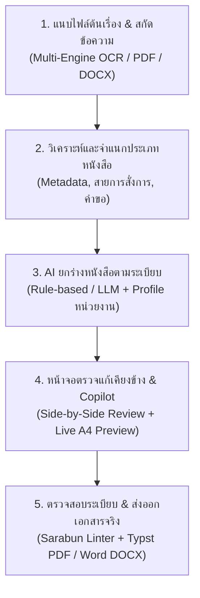

# 📑 แผนงานและข้อมูลสถาปัตยกรรมการพัฒนาระบบ (Development Plan & Architecture Specification)
## Thai GovDoc AI Studio — ระบบร่างและผลิตหนังสือราชการไทยอัจฉริยะ
**เวอร์ชันเอกสาร:** 2.2 (อัปเดตล่าสุด: พฤศจิกายน ๒๕๖๙)  
**สถานะการพัฒนา:** ดำเนินการแล้วเสร็จ Phase 1 – 8.9 (136 tests: ผ่าน 131 / ข้าม 5 ตามสภาพแวดล้อม / ล้มเหลว 0)  
**อ้างอิงกฎหมายและระเบียบ:** ระเบียบสำนักนายกรัฐมนตรีว่าด้วยงานสารบรรณ พ.ศ. ๒๕๒๖ และที่แก้ไขเพิ่มเติม, ระเบียบกรุงเทพมหานครว่าด้วยงานสารบรรณ

---

## 1. บทนำและเป้าหมายเชิงยุทธศาสตร์ (Vision & Strategic Goals)

งานสารบรรณและหนังสือราชการเป็นหัวใจหลักในการขับเคลื่อนระบบราชการไทย แต่ในปัจจุบันประสบปัญหาสำคัญ 3 ประการ:
1. **ความล่าช้าในการยกร่าง:** เจ้าหน้าที่ต้องใช้เวลา 30–60 นาทีต่อฉบับ ในการค้นหาระเบียบ ตรวจสอบสายการสั่งการ และจัดรูปแบบย่อหน้า
2. **ความผิดพลาดด้านระเบียบและรูปแบบ:** ปัญหาการใช้คำขึ้นต้น-ลงท้ายผิดระดับชั้น, การจัดระยะขอบและตราครุฑผิดสัดส่วน, สระลอยและการตัดคำไม่ชิดขอบในไฟล์ Word
3. **ข้อจำกัดในการอ่านเอกสารสแกน:** เอกสารต้นเรื่องส่วนใหญ่เป็นไฟล์สแกนที่มีลายมือเกษียนสั่งการและรอยตรายาง ซึ่งระบบ OCR ทั่วไปอ่านไม่ออก ทำให้เกิดการดึงชื่อไฟล์ดิบมาใส่แทนข้อความจริง

**เป้าหมายของ Thai GovDoc AI Studio:**  
สร้างระบบอัจฉริยะแบบ **Human-in-the-loop** ที่ลดระยะเวลาในการร่างหนังสือลงเหลือ **ไม่เกิน 2 นาทีต่อฉบับ** โดยยังคงความถูกต้องตามระเบียบงานสารบรรณ 100% และส่งออกเป็นเอกสารราชการจริงทั้งรูปแบบ Vector PDF (Typst) และ Editable Word (`.docx`) พร้อมระบบทะเบียนคุมสารบรรณครบวงจร

---

## 2. ทางเข้าใช้งาน ๒ ระบบ (Dual Entry Points Architecture)

ระบบถูกออกแบบให้มีสถาปัตยกรรมแบบ Decoupled แยกชั้นระหว่างส่วนต่อประสานผู้ใช้และการให้บริการภายนอก:
1. **Interactive User Studio (Streamlit):**
   - รันผ่านคำสั่ง `streamlit run web/app.py --server.port 8501`
   - เหมาะสำหรับเจ้าหน้าที่สารบรรณ: หน้าจอ Split-screen ซ้าย-ขวา, สลับ 3 แท็บ (ร่างเอกสาร, พรีวิว/ส่งออก, ตั้งค่าหน่วยงาน), Live A4 Preview, และ AI Copilot
2. **Enterprise Integration Gateway (FastAPI):**
   - รันผ่านโมดูล `core/api.py` (Uvicorn ASGI)
   - เหมาะสำหรับระบบงานภายนอก (เช่น e-Document / ERP): ให้บริการ Endpoint มาตรฐานแบบ JSON:
     - `POST /draft`: รับบริบทต้นเรื่อง ส่งกลับ `GovDocumentSchema`
     - `POST /refine`: ส่งคำสั่ง Copilot เพื่อขัดเกลาสำนวนรายย่อหน้า
     - `POST /validate`: ตรวจสอบระเบียบสารบรรณด้วย Linter 14 กฎ
     - `POST /export/typst`: คอมไพล์ Typst ส่งออก Vector PDF
     - `POST /registry/issue`: ลงรับและออกเลขที่หนังสือราชการใน SQLite

---

## 3. กระบวนการทำงานหลัก 5 ขั้นตอน (The 5-Step Core Workflow)

สถาปัตยกรรมของระบบถูกออกแบบตาม Flow การทำงานจริงของเจ้าหน้าที่สารบรรณ:



### รายละเอียดของแต่ละขั้นตอน:
1. **ขั้นตอนที่ 1: แนบไฟล์ต้นเรื่อง (Ingestion & Fail-Safe Extraction)**
   - รองรับไฟล์ PDF ดิจิทัล, ไฟล์สแกน/รูปภาพ (PNG, JPG), เอกสาร Word (`.docx`), และ Text
   - ทำงานผ่าน **Multi-Engine OCR**: Gemini Vision (Online) + Docker Tesseract Thai (Offline)
   - **Fail-Safe Guard:** หากถอดข้อความไม่ได้ ระบบจะหยุดทันที แจ้งเตือนผู้ใช้ และห้ามยกร่างต่อจากชื่อไฟล์
2. **ขั้นตอนที่ 2: ระบุชนิดหนังสือและวิเคราะห์โครงสร้าง (Classification & Parsing)**
   - สกัดเลขที่หนังสือ, วันที่ พ.ศ., หน่วยงานผู้ส่ง, เรื่อง, และรายการเอกสารแนบ
   - ถอดสายการสั่งการจากเกษียนหนังสือ (Routing Notes) และตรายางรับหนังสือ
3. **ขั้นตอนที่ 3: ระบบยกร่างหนังสือตามระเบียบ (AI Drafting Engine)**
   - รองรับทั้งหนังสือภายนอก (โครงสร้าง 3 ภาค) และหนังสือภายใน/บันทึกข้อความ (โครงสร้าง 4 ส่วนตามแบบ กทม.)
   - ดึงข้อมูลหน่วยงาน ผู้ลงนาม และเลขที่หนังสือจาก **User Organization Profile** โดยตรง
   - มีคลังข้อกฎหมายจริงสำหรับคำขอแต่ละประเภท (ห้าม AI แต่งข้อกฎหมายขึ้นเอง)
4. **ขั้นตอนที่ 4: ตรวจสอบและแก้ไขเคียงข้าง (Human-in-the-loop Review)**
   - Split-Screen Workspace: ต้นฉบับอยู่ฝั่งซ้าย หน้าร่างและแบบฟอร์มอยู่ฝั่งขวา
   - Live A4 Preview แสดงผลหน้าเอกสารเสมือนจริงแบบเรียลไทม์
   - AI Copilot ช่วยเกลาสำนวน ปรับเป็นทางการ ย่อความ หรือสลับเลขไทย/อารบิกเฉพาะจุด
5. **ขั้นตอนที่ 5: ตรวจสอบความถูกต้องและส่งออกจริง (Validation & Multi-Format Export)**
   - ตรวจสอบผ่าน Automated Sarabun Linter (ตรวจจับชื่อไฟล์หลุด, รูปแบบวันที่, คำขึ้นต้น-ลงท้าย)
   - ส่งออก Vector PDF ด้วย Typst ขอบกระดาษ 3-2-2.5 ซม. ตราครุฑเวกเตอร์คมชัด
   - ส่งออก Editable Word (`.docx`) พร้อมระบบแทรก ZWSP ตัดคำไทยชิดขอบ สระไม่ลอย
   - บันทึกประวัติและลงทะเบียนรับ-ส่งในสมุดทะเบียนคุมสารบรรณอิเล็กทรอนิกส์

---

## 4. สรุปผลการพัฒนาที่แล้วเสร็จ (Completed Development Phases: Phase 1 – 8.9)

ระบบผ่านการพัฒนาและทดสอบครบถ้วนทั้ง 8 ระยะ รวม **136 การทดสอบ (0 failed)** โดยเทสที่ต้องใช้ headless browser หรือ OCR จะ **skip อัตโนมัติ** เมื่อสภาพแวดล้อมไม่พร้อม (ดู `tests/conftest.py`) และจะถูกนับรวมเมื่อรันบนเครื่องที่มีเครื่องมือครบ:

| ระยะการพัฒนา (Phase) | ขอบเขตงานสำคัญ | ไฟล์และโมดูลที่เกี่ยวข้อง | สถานะ |
| :--- | :--- | :--- | :---: |
| **Phase 1: Core Foundation & Thai NLP** | • ตัวตัดคำภาษาไทย PyThaiNLP แทรก ZWSP (`\u200b`)<br/>• ตัวแปลงเลขไทย-อารบิกสองทิศทาง<br/>• Word Exporter (Thai Distributed, rFonts)<br/>• Typst Exporter (Vector PDF ตราครุฑ 3 ซม./1.5 ซม.)<br/>• Sarabun Linter ตรวจคำนำหน้าวันที่ และคำขึ้นต้น | `core/thai_segmenter.py`<br/>`core/word_exporter.py`<br/>`core/typst_exporter.py`<br/>`core/linter.py` | ✅ สำเร็จ |
| **Phase 2: Ingestion & Preprocessing** | • OpenCV Preprocessing: ปรับกระดาษเอียง (Deskew), Contrast (CLAHE), Binarize<br/>• ตัวสกัดข้อความ DOCX (ย่อหน้า + ตารางส่วนหัว)<br/>• ตัวแยก Metadata วันที่, เลขที่, เรื่อง, หน่วยงาน<br/>• Document Registry ฐานข้อมูล SQLite | `core/ocr_preprocessor.py`<br/>`core/extractor.py`<br/>`core/registry.py` | ✅ สำเร็จ |
| **Phase 3: Audit Trail & Copilot** | • ระบบ Diff Engine คำนวณความต่างระดับคำและระดับฟิลด์<br/>• AuditManager บันทึกประวัติเวอร์ชันและผู้แก้ไข<br/>• AI Copilot: `formal`, `concise`, `legal_ref`, `convert_type` | `core/audit.py`<br/>`core/copilot.py` | ✅ สำเร็จ |
| **Phase 4: Smart Placeholders & Memos** | • ระบบตรวจจับ Smart Placeholders (`[✏️ ...]`)<br/>• เจตนาการร่าง `MEMO_REVIEW` (รายงานการพิจารณา/เกษียนเรื่องเดิม)<br/>• จัดการข้ออ้างถึงและสิ่งที่ส่งมาด้วยในบันทึกข้อความ | `core/models.py`<br/>`core/ai_drafter.py` | ✅ สำเร็จ |
| **Phase 5: Production Readiness** | • รองรับการฝังภาพลายเซ็นดิจิทัลใน PDF และ Word<br/>• คลังแม่แบบมาตรฐาน 8 หมวดหมู่ (PRESET_TEMPLATES)<br/>• AI Drafter Fallback: Gemini $\rightarrow$ OpenAI $\rightarrow$ Rule-based | `core/templates_library.py`<br/>`core/pdf_exporter.py` | ✅ สำเร็จ |
| **Phase 6: BMA Memo Template & Hierarchy** | • โครงสร้าง 4 ส่วนตามแบบ กทม.: ต้นเรื่อง, ข้อเท็จจริง, ข้อกฎหมาย (ถ้ามี), ข้อพิจารณาและเสนอแนะ, ประโยคลงท้าย<br/>• ระบบย่อหน้าตามระดับชั้น (2.5 ซม., 3.5 ซม., 4.5 ซม.)<br/>• ระดับชั้นการเสนอเรื่อง (`MemoHierarchyLevel`): กลุ่มงาน $\rightarrow$ กอง $\rightarrow$ สำนัก $\rightarrow$ ปลัด $\rightarrow$ ผู้ว่าฯ | `core/memo_layout.py`<br/>`core/templates_library.py` | ✅ สำเร็จ |
| **Phase 7: Multi-Engine OCR & Profile** | • Local Docker Tesseract Container (`tha-tesseract:latest`) แบบออฟไลน์<br/>• Gemini Vision API ถอดลายมือเกษียนและตรายาง<br/>• ยุบช่องว่างพยัญชนะไทย และรวมสระอำจากการ OCR<br/>• Fail-Safe Halt: ป้องกันการนำชื่อไฟล์มาเป็นเรื่องหรืออ้างถึง<br/>• Linter Rule `RULE_FILENAME_IN_METADATA`<br/>• ระบบโปรไฟล์หน่วยงานของผู้ใช้ (`UserProfileSchema` $\rightarrow$ `data/user_profile.json`) พร้อมแท็บ UI ตั้งค่า | `core/extractor.py`<br/>`core/profile_manager.py`<br/>`core/ai_drafter.py`<br/>`core/linter.py`<br/>`web/app.py` | ✅ สำเร็จ |
| **Phase 8: Multi-Document Case Dossier** | • สถาปัตยกรรมสำนวนแฟ้มเรื่อง `SourceCase`, `SourceItem`, `RoutingNote`<br/>• ตัวสกัดเอกสารหลายฉบับในแฟ้ม และตรวจจับฉบับที่ส่งมาแทนหนังสือเดิม<br/>• ตัวสกัดสายบันทึกเกษียนสั่งการ (Chain of Command)<br/>• กลไกสังเคราะห์ย่อหน้า "ต้นเรื่อง" บันทึกข้อความ กทม. อัตโนมัติ | `core/case_dossier.py`<br/>`core/models.py`<br/>`core/extractor.py`<br/>`core/ai_drafter.py` | ✅ สำเร็จ |
| **Phase 8.1: Export Fidelity (Sprint 1)** | • `ExportOptions` (ฟอนต์/ครุฑ/เส้นคั่น/ระยะตัวอักษร/ฝังฟอนต์)<br/>• ฝังฟอนต์ TH Sarabun New/IT9/PSK เป็น `odttf` ตาม OOXML<br/>• ระยะตัวอักษร 0.4 pt ระดับ style, ขอบบนบันทึกข้อความ 1.5 ซม.<br/>• เลขหน้าไทย + หน้าแรกไม่แสดงเลข | `core/models.py`<br/>`core/docx_fonts.py`<br/>`core/word_exporter.py`<br/>`web/app.py` | ✅ สำเร็จ |
| **Phase 8.2: Layout Profiles & Segmented Header (P1–P2)** | • `LayoutProfile` แยกขอบ/ฟอนต์/ระยะตัวอักษร/การย่อหน้า/เลขหน้าต่อแม่แบบ<br/>• โปรไฟล์ `standard_memo`, `standard_external`, `form_it9_2026` (จากไฟล์จริง)<br/>• หัวฟอร์มเส้นทึบแบบแบ่งช่วง (`header_style=segmented`) แทนจุดไข่ปลา<br/>• `docGrid` linePitch และเลขหน้าอารบิก/ไทยตามโปรไฟล์ | `core/layout_profile.py`<br/>`core/word_exporter.py`<br/>`core/models.py`<br/>`web/app.py` | ✅ สำเร็จ |
| **Phase 8.3: Hierarchy Chain (P3)** | • สร้างชุด 3 ฉบับ (สำนัก→ปลัด, กอง→สำนัก, กลุ่มงาน→กอง) จากต้นเรื่องเดียว<br/>• ผู้รับ/ผู้ลงนาม/ประโยคลงท้ายตามระดับชั้น<br/>• Dropdown เลือกผู้รับภายหลังได้ | `core/hierarchy.py`<br/>`core/models.py`<br/>`web/app.py` | ✅ สำเร็จ |
| **Phase 8.4: Safety Gates (P0)** | • AI ไม่สร้างเลขที่/วันที่เอง (placeholder + วันที่ปัจจุบัน)<br/>• Linter: เลขที่ยังไม่ ออก/อ้างถึงหลายฉบับ<br/>• Security gate: บล็อก Gemini/OpenAI เมื่อเอกสารชั้นลับหรือโหมด local<br/>• Audit ID แยกฉบับร่างที่ยังไม่มีเลขที่ | `core/security.py`<br/>`core/thai_date.py`<br/>`core/ai_drafter.py`<br/>`core/linter.py`<br/>`web/app.py` | ✅ สำเร็จ |
| **Phase 8.5: Document Classifier (P1)** | • จำแนกหนังสือ 6 ชนิด/แบบ 1–11 จากคำสำคัญ<br/>• การ์ดยืนยันชนิดก่อนร่าง + dropdown แก้ชนิด<br/>• รองรับร่างอัตโนมัติเฉพาะหนังสือภายนอก/บันทึกข้อความ | `core/classifier.py`<br/>`web/app.py` | ✅ สำเร็จ |
| **Phase 8.6: Special Document Generators** | • Generator 4 ชนิด: ประทับตรา/สั่งการ/ประชาสัมพันธ์/หลักฐาน<br/>• Word layout เฉพาะ (ชื่อเอกสาร ความนำ ข้อแยกข้อ หมายเหตุ)<br/>• UI แก้ไขและพรีวิวเอกสารชนิดพิเศษ | `core/special_drafter.py`<br/>`core/word_exporter.py`<br/>`web/app.py` | ✅ สำเร็จ |
| **Phase 8.7: Flexible Sections** | • หัวข้อเอกสาร 12 ส่วนแบบเพิ่ม/ลบ/แก้ไข/สลับลำดับได้<br/>• `sections` เป็นแหล่งความจริง + sync กลับฟิลด์เดิม<br/>• Word/Preview เรนเดอร์ตามลำดับหัวข้อจริง | `core/sections.py`<br/>`core/models.py`<br/>`core/word_exporter.py`<br/>`web/app.py` | ✅ สำเร็จ |
| **Phase 8.8: Header Fit & Blank Number** | • บีบตัวอักษร (w:w) ให้บรรทัดส่วนราชการอยู่ในบรรทัดเดียว<br/>• เลขที่หนังสือแบบเว้นช่อง ......../พ.ศ. ให้เขียนเลขเอง<br/>• Checkbox แสดง/ซ่อนแต่ละหัวข้อ และซ่อนอัตโนมัติเมื่อเนื้อหาว่าง | `core/models.py`<br/>`core/thai_date.py`<br/>`core/word_exporter.py`<br/>`web/app.py` | ✅ สำเร็จ |
| **Phase 8.9: Edit Status & Save** | • สถานะ ฉบับร่าง/กำลังแก้ไข/บันทึกแล้ว<br/>• ปุ่มบันทึกทั้งหมด + Audit Trail ทุกครั้ง<br/>• เขียนสถานะลง DOCX core properties | `core/models.py`<br/>`core/word_exporter.py`<br/>`web/app.py` | ✅ สำเร็จ |

---

## 5. โครงสร้างข้อมูลและโมเดลสถาปัตยกรรม (Data Models & Schemas)

### 5.1. โปรไฟล์หน่วยงานของผู้ใช้ (`UserProfileSchema`)
บันทึกอย่างถาวรใน `data/user_profile.json` เพื่อใช้เป็นค่าตั้งต้นของการยกร่างทุกฉบับ:

```python
class UserProfileSchema(BaseModel):
    dept_name: str          # สำนัก/กรม เช่น "สำนักวัฒนธรรม กีฬา และการท่องเที่ยว"
    division_name: str      # กอง/ฝ่าย เช่น "กองการกีฬา"
    section_name: str       # กลุ่มงาน เช่น "กลุ่มงานส่งเสริมกีฬา"
    department_full: str    # ชื่อเต็มหัวบันทึกข้อความ พร้อมเบอร์โทรและโทรสาร
    doc_origin_code: str    # รหัสพยัญชนะนำหน้าเลขหนังสือ เช่น "กท ๐๒๐๔/"
    signatory_name: str     # ชื่อผู้มีอำนาจลงนามในวงเล็บ เช่น "(นายสิงห์ ลิ้มพิรัตน์)"
    signatory_position: str # ตำแหน่งผู้ลงนาม
    contact_dept: str       # หน่วยงานเจ้าของเรื่อง
    contact_tel: str        # เบอร์โทรศัพท์
    contact_fax: str        # เบอร์โทรสาร
    contact_email: Optional[str]
    hierarchy_default: MemoHierarchyLevel
```

### 5.2. บริบทเอกสารต้นเรื่องและสถานะการสกัด (`SourceDocumentContext`)
ควบคุมความปลอดภัยของข้อมูลต้นเรื่องพร้อมกลไก Fail-Safe:

```python
class SourceDocumentContext(BaseModel):
    source_filename: str
    source_dept: Optional[str]
    source_doc_no: Optional[str]
    source_date: Optional[str]
    source_subject: Optional[str]
    source_salutation: Optional[str]
    is_scanned: bool
    page_count: int
    preview_image_path: Optional[str]
    raw_text: str
    summary: str
    core_issues: List[str]
    requested_action: Optional[str]
    extraction_failed: bool          # กลไก Fail-Safe: ล้มเหลวหรือไม่
    extraction_error: Optional[str]   # ข้อความแจ้งเตือนผู้ใช้
    ocr_engine_used: Optional[str]    # Gemini Vision หรือ Local Docker Tesseract
    source_case: Optional[SourceCase] # ข้อมูลแฟ้มสำนวนเรื่องและสายเกษียนสั่งการ
```

### 5.3. สำนวนแฟ้มเรื่องสารบรรณและสายเกษียนสั่งการ (Case Dossier Models)
รองรับแฟ้มเรื่องราชการที่มีหนังสือเข้าหลายฉบับและมีลายมือเกษียนสั่งการหลายลำดับชั้น:

```python
class RoutingNote(BaseModel):
    author: str               # ผู้เกษียน/ลงนาม เช่น "ผอ.สำนักวัฒนธรรม กีฬา และการท่องเที่ยว"
    position: Optional[str]   # ตำแหน่ง
    target: Optional[str]     # เสนอต่อไปยังผู้ใด เช่น "เรียน ปลัดกรุงเทพมหานคร"
    order_text: str           # ข้อความเกษียน/คำสั่งการ
    order_date: Optional[str] # วันที่เกษียน
    signature_present: bool

class SourceItem(BaseModel):
    item_id: str
    title: str
    doc_no: Optional[str]
    doc_date: Optional[str]
    sender: Optional[str]
    page_start: int
    page_end: int
    doc_type: str             # "external", "internal", "project", "attachment"
    replaces_item_id: Optional[str]  # อ้างถึงฉบับเดิมที่ฉบับนี้มายกเลิก/ส่งมาแทน

class SourceCase(BaseModel):
    case_title: str
    items: List[SourceItem]
    routing_notes: List[RoutingNote]
    deadlines: List[str]
    requested_items: List[str]
    raw_text: Optional[str]

    def synthesize_memo_intro(self) -> str:
        # สังเคราะห์ย่อหน้า "ต้นเรื่อง" ที่ระบุหนังสือภายนอกเดิมและสายเกษียนสั่งการตามลำดับชั้นอย่างเป็นทางการ
        ...
```

### 5.4. โครงสร้างหนังสือบันทึกข้อความ กทม. (BMA Memo Structure)
หนังสือบันทึกข้อความภายในจะถูกแบ่งออกเป็น 4 ย่อหน้ามาตรฐาน และ 1 ประโยคลงท้าย:
1. **`memo_intro` (ต้นเรื่อง - ต้องมีทุกครั้ง):** ความเป็นมาของเรื่องเดิม หนังสือ/คำร้องที่ได้รับ และประวัติการเกษียนสั่งการ
2. **`memo_facts` (ข้อเท็จจริง - ต้องมีทุกครั้ง):** ผลการตรวจสอบข้อเท็จจริง รายการคำขอ ๑., ๒., ๓. หรือเงื่อนไขของกิจกรรม
3. **`memo_law` (ข้อกฎหมาย - ถ้ามี):** อ้างอิงพระราชบัญญัติหรือระเบียบที่เกี่ยวข้อง (เช่น พ.ร.บ. เครื่องหมายราชการ พ.ศ. ๒๔๘๒, ระเบียบการใช้สถานที่) โดยห้ามแต่งข้อกฎหมายขึ้นเอง
4. **`memo_consideration` (ข้อพิจารณาและเสนอแนะ - ต้องมีทุกครั้ง):** การวิเคราะห์ข้อดีข้อเสีย และข้อเสนอแนะของหน่วยงาน
5. **`memo_request` (ประโยคลงท้ายตามระดับชั้น):** ประโยคลงท้ายตามลำดับบังคับบัญชา เช่น
   - ระดับสำนัก $\rightarrow$ ปลัด: *"จึงเรียนมาเพื่อโปรดพิจารณา หากเห็นชอบโปรดนำเรียนผู้ว่าราชการกรุงเทพมหานคร เพื่อโปรดพิจารณา..."*
   - ระดับกอง $\rightarrow$ สำนัก: *"จึงเรียนมาเพื่อโปรดพิจารณาลงนามหนังสือเรียนปลัดกรุงเทพมหานครที่แนบ"*
   - ระดับกลุ่มงาน $\rightarrow$ กอง: *"จึงเรียนมาเพื่อโปรดพิจารณานำเรียนผู้อำนวยการกองลงนามในหนังสือที่แนบ"*

---

## 6. ทะเบียนความเสี่ยงและมาตรการควบคุม (Risk Register & Mitigations)

| ลำดับ | ความเสี่ยง (Risk) | ผลกระทบ | โอกาสเกิด | มาตรการควบคุมทางเทคนิค (Technical Mitigations) |
| :---: | :--- | :---: | :---: | :--- |
| **R1** | **ข้อมูลส่วนบุคคลรั่วไหล (PDPA / Sensitive Data Leak)** | สูง | ปานกลาง | เพิ่มตัวกรอง Regular Expression ตรวจจับเลขบัตรประจำตัวประชาชน 13 หลัก และเลขบัญชีธนาคาร พร้อมระบบ Masking อัตโนมัติ (`XXX-X-XXXXX-X`) |
| **R2** | **ชื่อไฟล์หลุดเข้าไปในหัวเรื่อง/อ้างถึง (Raw Filename Leak)** | สูง | ต่ำ (เคยพบ) | ๑. กลไก Ingestion Fail-Safe หยุดทันทีหาก OCR สกัดข้อความไม่ได้<br/>๒. Linter Rule `RULE_FILENAME_IN_METADATA` บล็อกการส่งออกหากพบนามสกุลไฟล์ (`.pdf`, `.docx`) |
| **R3** | **AI แต่งข้อกฎหมายหรือระเบียบเอง (Legal Hallucination)** | วิกฤต | สูง (หากปล่อย LLM อิสระ) | ๑. กำหนดให้ AI ดึงเฉพาะข้อกฎหมายจากคลังกฎหมายจริง (Curated Statutes)<br/>๒. หากไม่เข้าข่าย ให้เว้นว่าง `memo_law = None` ห้ามจินตนาการมาตราหรือระเบียบขึ้นเองเด็ดขาด |
| **R4** | **ประโยคลงท้ายไม่ตรงระดับชั้นบังคับบัญชา (Hierarchy Mismatch)** | ปานกลาง | ปานกลาง | บังคับใช้ `MemoHierarchyLevel` Enum 5 ระดับชั้น กำหนดประโยคลงท้ายตายตัวตามตำแหน่งผู้รับหนังสือ ไม่เปิดให้โมเดลภาษาแต่งประโยคลงท้ายเอง |
| **R5** | **คุณภาพไฟล์สแกนต่ำ ทำให้อ่านหนังสือไม่ออก (Low-DPI OCR Failure)** | ปานกลาง | ปานกลาง | ๑. สถาปัตยกรรม Multi-Engine OCR: สลับ Gemini Vision API และ Docker Tesseract<br/>๒. ตัวประมวลผลภาพ OpenCV (Deskew, CLAHE, Adaptive Binarization)<br/>๓. ช่องทาง Manual Input สำหรับให้เจ้าหน้าที่พิมพ์ข้อความเอง |

---

## 7. เกณฑ์การตรวจรับการทำงานรายระยะ (Acceptance Criteria per Phase)

- **Phase 1 (Core Foundation):**
  - [x] ส่งออกไฟล์ Word (.docx) มีการตัดคำภาษาไทยด้วย ZWSP ชิดขอบกระดาษทุกบรรทัด สระไม่ลอย
  - [x] เรนเดอร์ Typst Vector PDF ตราครุฑ 3 ซม. ขอบกระดาษ 3-2-2.5 ซม. สมบูรณ์
  - [x] แปลงเลขไทยและเลขอารบิกได้สองทิศทางอย่างแม่นยำ
- **Phase 2 (Ingestion & Registry):**
  - [x] สกัดข้อความจากเอกสาร DOCX และรูปภาพ/สแกน (ผ่าน Deskew) สำเร็จ
  - [x] แยกแยะ Metadata (ที่, วันที่, เรื่อง, หน่วยงาน) และลงบันทึกลงใน SQLite Registry
- **Phase 3 (Audit & Copilot):**
  - [x] คำนวณความต่างระดับคำและระดับฟิลด์ (Diff Engine) ได้ถูกต้อง
  - [x] คำสั่ง Copilot (formal, concise, legal_ref, convert_type) ทำงานได้ตรงตามสั่ง
- **Phase 4 (Smart Placeholders):**
  - [x] ตรวจจับ Placeholders รูปแบบ `[✏️ ระบุ...]` และนับจำนวนคงเหลือได้ถูกต้อง
  - [x] รองรับเจตนา `MEMO_REVIEW` สำหรับรายงานการพิจารณาเรื่องเดิม
- **Phase 5 (Production Export):**
  - [x] รองรับการฝังภาพลายเซ็นดิจิทัลใน PDF และ Word
  - [x] มีกลไก Fallback อัจฉริยะ (Gemini $\rightarrow$ OpenAI $\rightarrow$ Rule-based)
- **Phase 6 (BMA Memo & Hierarchy):**
  - [x] บันทึกข้อความแบ่ง 4 หัวข้อมาตรฐาน กทม. + ประโยคลงท้ายตามระดับชั้น
  - [x] การเยื้องระดับชั้น 2.5, 3.5, 4.5 ซม. เป็นไปตามระเบียบงานสารบรรณ
- **Phase 7 (Multi-Engine OCR & Profile):**
  - [x] มีกลไก Multi-Engine OCR (Gemini Vision + Docker Tesseract) และ skip อัตโนมัติเมื่อไม่มี engine
  - [x] กลไก Fail-Safe หยุดการยกร่างเมื่อ OCR อ่านไม่ออก ป้องกันชื่อไฟล์หลุดเข้าเนื้อหา
  - [x] บันทึกและดึงโปรไฟล์หน่วยงานของผู้ใช้จาก `data/user_profile.json`
- **Phase 8 (Case Dossier & Chain of Command):**
  - [x] แยกแยะเอกสารหลายฉบับในแฟ้ม และตรวจจับฉบับที่ส่งมาแทนหนังสือเดิมได้
  - [x] สกัดสายบันทึกเกษียนสั่งการ (Chain of Command) และสังเคราะห์ย่อหน้า "ต้นเรื่อง" อัตโนมัติ

---

## 8. แผนการพัฒนาระยะถัดไป (Future Roadmap: Phase 9 – 10)

### 🚩 Phase 9: Curated Legal Knowledge Base (คลังข้อกฎหมายและระเบียบมาตรฐาน)
- ขยายฐานข้อมูลระเบียบราชการและหนังสือสั่งการของกรุงเทพมหานครให้ครอบคลุมทุกสายงาน (การศึกษา, โยธา, สิ่งแวดล้อม, สาธารณสุข)
- เชื่อมต่อตัวตรวจค้นแบบ Semantic Search ค้นหากฎหมายเฉพาะทางประกอบการยกร่าง โดยยึดตัวบทปฐมภูมิและฉบับที่มีผลใช้บังคับ
- แสดงชื่อแหล่งออกกฎหมาย มาตรา/ข้อ วันที่มีผล URL และข้อความต้นทางทุกผลลัพธ์ พร้อมบันทึกการอ้างอิงกลับไปยังย่อหน้าร่าง
- ปิดกั้นการสร้างข้อกฎหมายที่ไม่พบในคลัง และให้เจ้าหน้าที่ตรวจยืนยันก่อนนำไปใช้

### 🚩 Phase 10: Multi-Document Review, Hierarchical Approval & E-Office Integration
- เปรียบเทียบหนังสือหลายฉบับหรือฉบับแก้ไขในแฟ้มเดียว แสดงข้อความที่เปลี่ยนพร้อมเลขหน้า/ส่วนต้นทาง และให้ผู้ใช้ยืนยันข้อเท็จจริงก่อนสร้างบันทึกรายงานการพิจารณา
- เพิ่มปุ่ม "ส่งต่อขึ้นระดับถัดไป (Forward to Next Tier)" สำหรับสร้างบันทึกข้อความฉบับระดับกองและระดับสำนักอัตโนมัติ
- พัฒนา Connector เชื่อมโยงกับระบบ e-Saraban กทม. ผ่าน FastAPI Gateway เพื่อดึงเลขที่หนังสือและลงรับ-ส่งจริง

> แนวทางจัดลำดับนี้เทียบกับความสามารถที่ Ekkasarn เปิดเผยบนหน้าเว็บสาธารณะ โดยคงการอ้างอิงหลักฐานและการตรวจทานโดยเจ้าหน้าที่เป็นเงื่อนไข ดู [EKKASARN_BENCHMARK.md](EKKASARN_BENCHMARK.md)

---

## 9. สรุปโครงสร้างไดเรกทอรีโครงการ (Project Structure)

```text
หนังสือราชการ/
├── EXECUTIVE_SUMMARY.md        # สรุปภาพรวมผู้บริหาร 1 หน้า (Executive Summary)
├── DEVELOPMENT_PLAN.md         # แผนงานและข้อกำหนดสถาปัตยกรรมฉบับสมบูรณ์ (ไฟล์นี้)
├── README.md                   # คู่มือภาพรวมและแนวทางการติดตั้งระบบ
├── DESIGN.md                   # สถาปัตยกรรมระบบและ Data Schemas
├── SARABAN_RULES.md            # คู่มือระเบียบงานสารบรรณ พ.ศ. ๒๕๒๖
├── PROMPT_ENGINEERING.md       # Prompts และตัวอย่าง Few-shot สำหรับ LLM
├── EXPORT_ENGINE.md            # รายละเอียดการคอมไพล์ Typst PDF และ Word DOCX
├── Dockerfile.tesseract        # Dockerfile สำหรับ Local Thai Tesseract OCR
├── pytest.ini                  # การตั้งค่าชุดทดสอบ
│
├── core/                       # แกนหลักของการประมวลผล (Core Business Logic)
│   ├── models.py               # GovDocumentSchema, UserProfileSchema, SourceCase, RoutingNote
│   ├── case_dossier.py         # ตัวประมวลผลแฟ้มสำนวนเรื่องและสายเกษียนสั่งการ (Phase 8)
│   ├── profile_manager.py      # ตัวจัดการโปรไฟล์หน่วยงานและผู้ลงนาม (user_profile.json)
│   ├── extractor.py            # Multi-Engine OCR (Gemini Vision + Docker Tesseract) & Fail-Safe
│   ├── ocr_preprocessor.py     # ตัวประมวลผลภาพ (Deskew, CLAHE Contrast, Binarize)
│   ├── ai_drafter.py           # สมองกลยกร่างหนังสือตามระเบียบ 3 ภาค และบันทึกข้อความ กทม.
│   ├── linter.py               # Automated Sarabun Linter ตรวจระเบียบและชื่อไฟล์ดิบ
│   ├── memo_layout.py          # ตัวจัดหน้าบันทึกข้อความ กทม. และระบบ Indentation
│   ├── layout_profile.py     # โปรไฟล์การจัดหน้าต่อแม่แบบ (ขอบ/ฟอนต์/เลขหน้า)
│   ├── hierarchy.py         # สร้างชุดบันทึกตามลำดับชั้น (P3)
│   ├── security.py          # นโยบายบล็อก AI ภายนอกสำหรับข้อมูลชั้นลับ
│   ├── classifier.py        # จำแนกหนังสือ 6 ชนิด/แบบ 1–11 + การ์ดยืนยัน
│   ├── special_drafter.py   # generator เอกสารชนิดพิเศษ 4 ชนิด
│   ├── sections.py          # หัวข้อเอกสารอิสระ (เพิ่ม/ลบ/สลับ/ซิงก์ฟิลด์)
│   ├── thai_date.py         # วันที่ไทย พ.ศ. (ไม่สร้างเลขที่/วันที่เอง)
│   ├── word_exporter.py        # ตัวส่งออกไฟล์ Word (.docx) ตัดคำด้วย ZWSP ชิดขอบกระดาษ
│   ├── typst_exporter.py       # ตัวสร้างและคอมไพล์ Typst เป็น Vector PDF
│   ├── audit.py                # ระบบติดตามประวัติการแก้ไข (Audit Trail & Diff)
│   ├── copilot.py              # ผู้ช่วย AI Copilot ขัดเกลาภาษาเฉพาะจุด
│   ├── registry.py             # ระบบทะเบียนรับ-ส่ง และออกเลขที่หนังสือ
│   ├── api.py                  # Enterprise RESTful API Gateway (FastAPI)
│   └── templates_library.py    # คลังแม่แบบมาตรฐาน 8 หมวดหมู่ และแบบฟอร์ม กทม.
│
├── data/                       # ข้อมูลถาวรของระบบ
│   ├── user_profile.json       # ข้อมูลการตั้งค่าหน่วยงานของผู้ใช้
│   ├── audit.db                # ฐานข้อมูลประวัติการแก้ไขและเวอร์ชัน
│   └── edocument.db            # ฐานข้อมูลสมุดทะเบียนคุมสารบรรณ
│
├── uploads/                    # โฟลเดอร์จัดเก็บไฟล์ต้นเรื่องที่แนบเข้ามา
├── assets/                     # ตราครุฑเวกเตอร์ (garuda.svg) และฟอนต์ TH Sarabun New/IT9/PSK 4 น้ำหนัก
├── tests/                      # ชุดทดสอบ 136 รายการ (0 failed; ข้าม browser/OCR ตามสภาพแวดล้อม)
└── web/                        # ระบบหน้าบ้าน (Web UI)
    └── app.py                  # แอปพลิเคชัน Streamlit หน้าจอ 3 แท็บ (ร่าง, ทะเบียน, ตั้งค่า)
```

---

## 10. ข้อมูลสเปกและข้อกำหนดการทำงานของระบบ (Runtime Specification)

| รายการ | สเปก / ค่ามาตรฐาน |
| :--- | :--- |
| **สภาพแวดล้อม (OS & Runtime)** | Windows 10/11, Python 3.12.0 x64 |
| **เว็บเฟรมเวิร์ก (Web Framework)** | Streamlit 1.52.0 (รันบนพอร์ต 8501 แบบ Headless) |
| **เกตเวย์องค์กร (API Gateway)** | FastAPI + Uvicorn ASGI (`core/api.py`) |
| **เครื่องมือเรนเดอร์ PDF** | Typst 0.15 (CLI หรือ Python binding `typst` ที่ฝัง compiler) — คอมไพล์ A4 Vector PDF ในเวลา 50-100 ms |
| **ฟอนต์สำหรับ PDF** | TH Sarabun New / IT9 / PSK ครบ 4 น้ำหนัก ใน `assets/fonts` (ระเบียบอนุญาต TH Sarabun New หรือ TH Sarabun PSK) |
| **เครื่องมือสร้าง Word** | `python-docx` 1.2.0 ร่วมกับ `pythainlp` 5.4.0 แทรก ZWSP (`\u200b`) และเปิดโหมด Thai Distributed |
| **เครื่องมือ OCR ท้องถิ่น** | Docker Engine + Image `tha-tesseract:latest` (Alpine + Tesseract 5.5.2 ภาษา `tha+eng`) |
| **เครื่องมือ Cloud AI** | Google Gemini API (`gemini-2.5-flash`) ผ่านไลบรารี `google-genai` |
| **ฐานข้อมูล (Database)** | SQLite 3 (ไฟล์ `audit.db` และ `edocument.db`) |
| **สถานะชุดทดสอบ** | 136 tests: 131 passed / 5 skipped / 0 failed (ด้วย `.venv` + `typst`) |

### ข้อจำกัดที่ทราบ (Known Limitations)

1. **PDF ผ่าน headless browser**: ในสภาพแวดล้อมที่ถูก sandbox จำกัดสิทธิ์ (เช่น CI บางระบบ) Microsoft Edge/Chrome อาจเปิดโพรไฟล์ไม่ได้ ทำให้เทส PDF 4 รายการ skip — บนเครื่องผู้ใช้ปกติจะทำงานได้
2. **OCR**: ต้องมี `GEMINI_API_KEY` หรือ Docker image `tha-tesseract`; หากไม่มี เทส OCR จะ skip และระบบจะเข้าสู่ Fail-Safe แทนการเดาข้อความ
3. **ฟอนต์ใน Word**: ไฟล์ `.docx` ฝังฟอนต์ TH Sarabun New ไว้แล้ว (odttf) จึงเปิดบนเครื่องอื่นได้โดยไม่ต้องติดตั้งฟอนต์; PDF ใช้ฟอนต์จาก `assets/fonts`
4. **เลขข้อในสายเกษียน**: ระบบสร้างเลขไทย `๑. ๒. ๓.`; หากหน่วยงานเลือกใช้เลขอารบิกทั้งฉบับ ต้องแปลงภายหลังด้วยคำสั่งสลับเลขของ Copilot

---

## 11. แนวทางพัฒนาหน้าจอผู้ใช้ใหม่ (Workspace UX/UI Development Guide)

### 11.1 เป้าหมายและขอบเขต

ปรับหน้าจอ Streamlit ให้เจ้าหน้าที่เริ่มงานได้เร็วขึ้นและเห็นสถานะของเอกสารชัดเจน โดยใช้ภาพหน้าจอ Ekkasarn AI ที่ผู้ใช้ให้มาเป็นข้อมูลอ้างอิงด้านการจัดลำดับงาน เช่น เมนูหลักด้านซ้าย พื้นที่เริ่มงานที่เด่น และประวัติการใช้งาน ทั้งนี้ให้ออกแบบอัตลักษณ์และรายละเอียดของ Thai GovDoc AI Studio เอง ไม่คัดลอกโลโก้ ข้อความเฉพาะ ภาพ หรือองค์ประกอบที่เป็นทรัพย์สินของผลิตภัณฑ์อื่น

การปรับรอบแรกเป็นงาน UI บนระบบเดิม ต้องรักษาความสามารถใน `core/` ไว้ และไม่ทำให้ผู้ใช้เข้าใจว่ามีฟังก์ชันซึ่งยังไม่ได้พัฒนา เช่น การสนทนากับ LLM แบบเต็มรูปแบบหรือคลังกฎหมายออนไลน์

### 11.2 หลักการออกแบบ

- ให้เริ่มจากงานหลักของเจ้าหน้าที่: แนบต้นเรื่องหรือเลือกแม่แบบ แล้วตรวจชนิดเอกสารก่อนยกร่าง
- ใช้ภาษาไทยที่กระชับ ปุ่มและสถานะต้องบอกการกระทำหรือผลลัพธ์อย่างตรงไปตรงมา
- ใช้พื้นหลังสว่าง ตัวอักษรสีเข้ม และสีเน้นหลักเพียงสีเดียวที่เหมาะกับภาพลักษณ์หน่วยงาน
- ใช้พื้นที่ว่าง เส้นแบ่ง และการจัดแนวแทนการซ้อนกล่องหรือการ์ดจำนวนมาก
- รักษาเอกลักษณ์เอกสารราชการในพรีวิวและไฟล์ส่งออก แยกการตกแต่งหน้าแอปออกจากรูปแบบหนังสือทางราชการ
- แสดงความเป็นส่วนตัวและสถานะการส่งข้อมูลไป AI ภายนอกในตำแหน่งที่ผู้ใช้เห็นก่อนเริ่มประมวลผล
- รองรับจอเดสก์ท็อปเป็นหลักในรอบแรก และจัดคอลัมน์ให้เรียงต่อกันบนจอแคบโดยไม่ซ่อนปุ่มสำคัญ

### 11.3 โครงสร้างหน้าจอและลำดับการทำงาน

**เมนูนำทางด้านซ้าย**

1. เริ่มร่างและตรวจแก้หนังสือ
2. แม่แบบหนังสือราชการ
3. สมุดทะเบียนรับ–ส่งและจองเลข
4. ตั้งค่าหน่วยงาน

ให้แสดงเฉพาะเมนูที่เชื่อมกับความสามารถซึ่งใช้งานได้จริงในระบบ หากมีเมนูประวัติเอกสารหรือคลังกฎหมายในอนาคต ต้องพัฒนาหน้าจอและแหล่งข้อมูลให้พร้อมก่อนจึงเพิ่มเมนูนั้น

**หน้าว่างก่อนเริ่มงาน**

- แสดงหัวข้อ “เริ่มร่างหนังสือราชการ” และคำอธิบายสั้น ๆ
- แสดงทางเลือกหลักสองทาง: แนบไฟล์ต้นเรื่อง และเลือกแม่แบบมาตรฐาน
- รองรับ PDF, DOCX, TXT และรูปภาพตามชนิดไฟล์ที่ระบบปัจจุบันรับได้
- แสดงตัวเลือกเริ่มต้นแบบรวดเร็วจากชนิด/แม่แบบที่ระบบรองรับ ไม่แสดงปุ่มที่ยังไม่มีการทำงาน
- แสดงข้อความแจ้งระดับข้อมูลและตัวเลือกอนุญาต AI ภายนอกก่อนการประมวลผล

**สถานะหลังแนบต้นเรื่อง**

1. กำลังอ่านและสกัดข้อความ
2. สกัดสำเร็จ หรือแจ้งข้อผิดพลาดพร้อมทางเลือกกรอกข้อความเอง
3. แสดงชนิดหนังสือที่ระบบจำแนกได้และให้เจ้าหน้าที่ยืนยันหรือแก้ไข
4. ให้ผู้ใช้เลือกเจตนาการร่างที่มีอยู่
5. เริ่มยกร่างและแสดงผลสำเร็จ/ข้อผิดพลาดอย่างชัดเจน

ห้ามข้ามการยืนยันชนิดหนังสือหรือ Fail-Safe เดิมเมื่อสกัดข้อความไม่ได้ และห้ามสร้างเลขที่หนังสือหรือข้อเท็จจริงที่ไม่มีในต้นเรื่องขึ้นเอง

**Workspace หลังมีฉบับร่าง**

- ใช้สองคอลัมน์บนจอกว้าง: ซ้ายเป็นต้นเรื่อง/ข้อมูลที่สกัดได้ ขวาเป็นร่างเอกสาร
- ฝั่งต้นเรื่องให้เห็นชื่อไฟล์ สถานะ OCR ข้อมูลสำคัญที่สกัดได้ และข้อความต้นทางแบบขยายดูได้
- ฝั่งร่างให้เข้าถึงการแก้ไข พรีวิว A4 ประวัติความเปลี่ยนแปลง และผล Sarabun Linter ได้โดยไม่สับสนกับต้นฉบับ
- แสดงชนิดหนังสือ สถานะบันทึก และจำนวนช่อง `[ระบุ...]` ที่ยังต้องเติม
- วางการกระทำหลักไว้ชัดเจน: บันทึก ตรวจระเบียบ ส่งออก Word/PDF
- บนจอแคบ ให้แสดงต้นเรื่องและร่างเป็นส่วนเรียงลำดับ พร้อมตัวควบคุมสลับดู ไม่บีบจนอ่านเอกสารไม่ได้

### 11.4 ขอบเขตการนำความสามารถเดิมมาใช้

รอบ UI แรกควรเรียกใช้ logic ที่มีอยู่แล้ว ได้แก่ `extract_source_document`, `classify_source_document`, `draft_from_context_*`, `PRESET_TEMPLATES`, editor, preview, linter, audit และ exporter โดยไม่สร้างเส้นทางทำงานซ้ำ

ช่องข้อความลักษณะ prompt อิสระจะเพิ่มได้ต่อเมื่อมี backend flow ที่รองรับการร่างจากคำสั่งโดยตรง พร้อมการถามยืนยันข้อมูลที่ขาด การจัดประเภท และ Fail-Safe ครบถ้วน ระหว่างนี้ให้ใช้ช่องอัปโหลด/เลือกแม่แบบและตัวเลือกเจตนาการร่างที่มีจริง

### 11.5 ขอบเขตไฟล์สำหรับการปรับ UI รอบแรก

| ไฟล์ | การเปลี่ยนแปลงที่คาดหมาย | สถานะ |
| :--- | :--- | :---: |
| `web/app.py` | จัดหน้าเริ่มต้น เมนูนำทาง สถานะงาน และ Workspace ใหม่ พร้อมปรับ CSS ที่ฝังอยู่ในไฟล์ | จำเป็น |
| `web/styles.css` | แยก CSS ออกจาก Python เพื่อดูแลรูปแบบหน้าได้สะดวก หากทีมเลือกแนวทางแยก stylesheet | ทางเลือก |
| `core/` และ `templates/` | ไม่เปลี่ยนในรอบ UI เว้นแต่พบข้อกำหนดด้านข้อมูลหรือการส่งออกที่ UI เดิมเรียกใช้ไม่ได้ และต้องบันทึกเหตุผลก่อนขยายขอบเขต | ไม่อยู่ในขอบเขตเริ่มต้น |

### 11.6 เกณฑ์ตรวจรับ UX/UI

- ผู้ใช้เริ่มงานใหม่ได้จากหน้าแรกโดยเลือกแนบต้นเรื่องหรือเลือกแม่แบบได้ทันที
- เมนูทุกข้อไปยังความสามารถที่มีอยู่จริง และไม่มีปุ่มลัดที่ทำให้เข้าใจว่าระบบรองรับงานที่ยังไม่พัฒนา
- ผู้ใช้มองเห็นสถานะ OCR การจำแนก การร่าง การบันทึก และการตรวจระเบียบในขั้นตอนที่เกี่ยวข้อง
- เจ้าหน้าที่ยืนยันชนิดเอกสารและตรวจข้อความก่อนส่งออกได้
- ต้นฉบับกับฉบับร่างแยกจากกันชัดเจน และยังเข้าถึงพรีวิว A4, Diff, Linter, Audit และการส่งออกได้
- การปรับ UI ไม่ลดทอนกฎความปลอดภัย Fail-Safe และการป้องกัน AI สร้างเลขที่/วันที่/ข้อกฎหมายเอง
- ภาษาไทยอ่านได้ชัดเจนบนจอปกติและจอแคบ ปุ่มมีชื่อที่สื่อความหมาย และสถานะไม่พึ่งสีเพียงอย่างเดียว

### 11.7 ลำดับการพัฒนา

1. ทำหน้าว่างและเมนูนำทาง โดยเชื่อมกับแท็บ/ความสามารถปัจจุบัน
2. จัด Workspace หลังแนบไฟล์และหลังสร้างร่างให้มีลำดับสถานะชัดเจน
3. ตรวจการเข้าถึงฟังก์ชันเดิม ได้แก่ แก้ไข พรีวิว Diff, Linter, Audit, DOCX และ PDF
4. เก็บข้อเสนอแนะจากเจ้าหน้าที่นำร่องก่อนพัฒนาแชตอิสระหรือย้าย frontend ไป Next.js
5. พิจารณาเพิ่มหน้าคลังข้อกฎหมาย ประวัติเอกสาร และการเชื่อม e-Saraban เมื่อแหล่งข้อมูล สิทธิ์ และ API พร้อม

